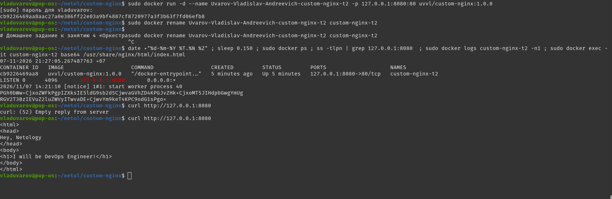
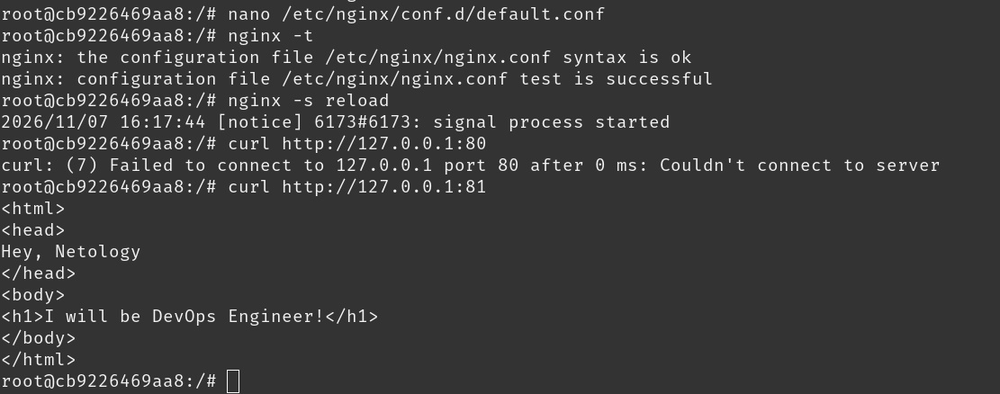
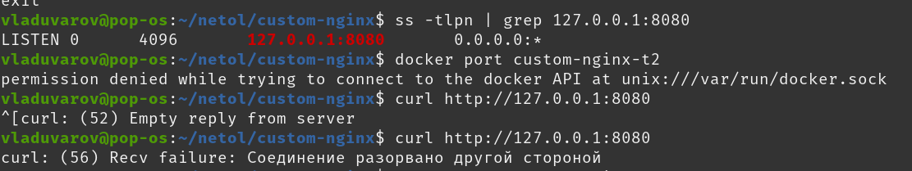
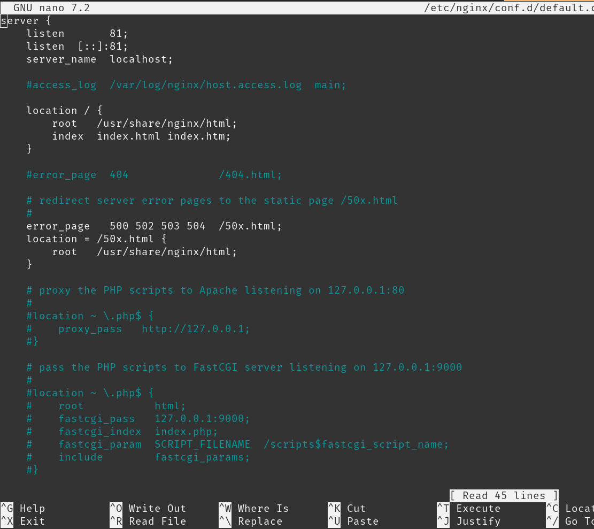
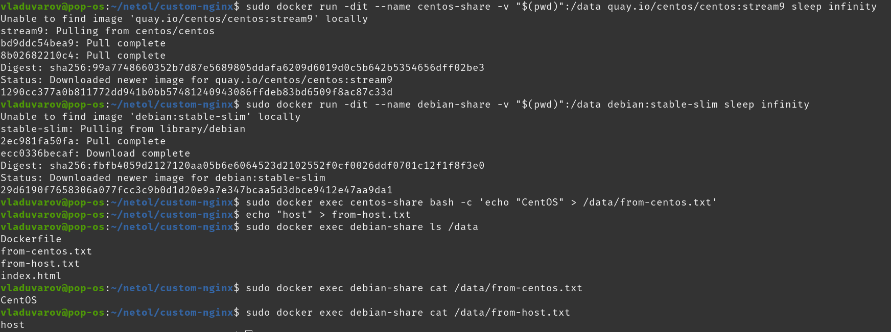
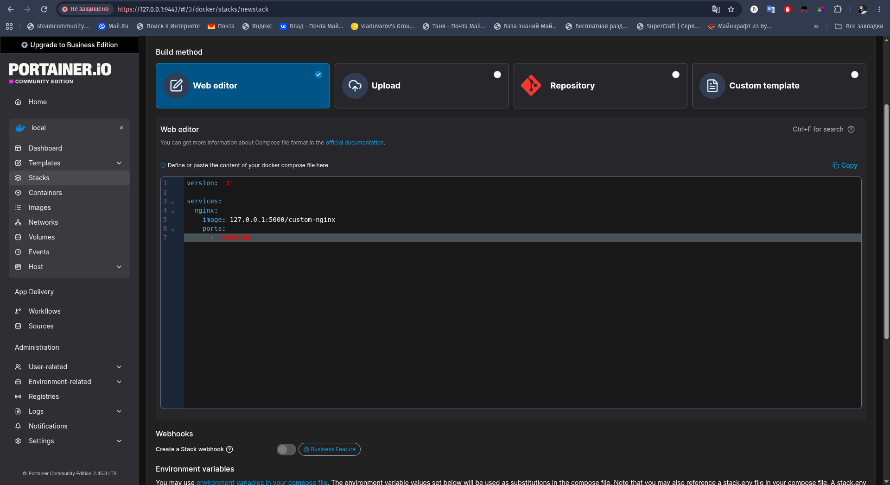
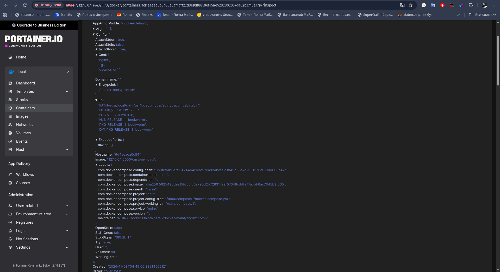
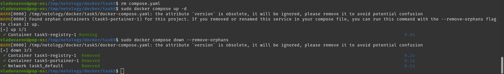
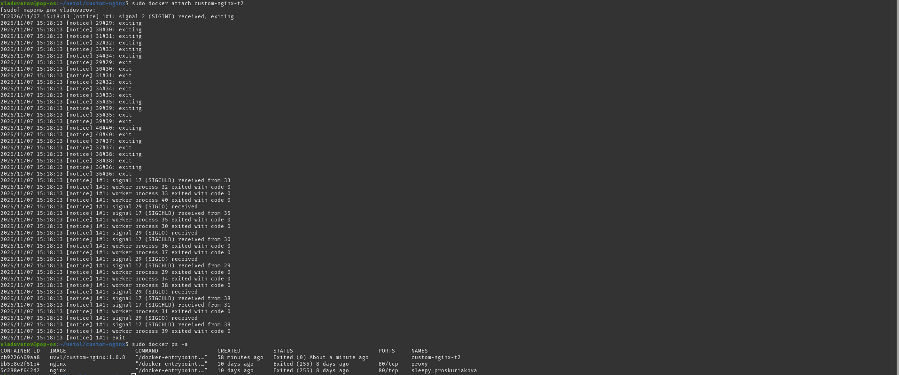

# Домашнее задание к занятию 05-virt-03 «Docker»

## Задача 1. Сборка образа custom-nginx

Скачан базовый образ `nginx:1.29.0`. Созданы `Dockerfile` и `index.html`: файл страницы скопирован в образ по пути `/usr/share/nginx/html/index.html`. Образ собран с тегом `uvvl/custom-nginx:1.0.0` и отправлен в Docker Hub.

Содержимое `Dockerfile`:

```dockerfile
FROM nginx:1.29.0
COPY index.html /usr/share/nginx/html/index.html
```

Ссылка на репозиторий: <https://hub.docker.com/r/uvvl/custom-nginx/general>

## Задача 2. Запуск и проверка контейнера

Контейнер запущен в фоне с именем `Uvarov-Vladislav-Andreevich-custom-nginx-t2`, порт хоста `127.0.0.1:8080` опубликован на порт 80 контейнера. Затем контейнер переименован в `custom-nginx-t2`.

Проверены состояние контейнера, опубликованный порт, лог nginx и содержимое `index.html` в контейнере. Страница проверена запросом `curl`.



## Задача 3. Подключение к потокам контейнера и изменение конфигурации

Команда `docker attach custom-nginx-t2` подключает терминал к стандартным потокам контейнера. Нажатие Ctrl+C завершает основной процесс nginx, поэтому контейнер останавливается.

Контейнер перезапущен. В интерактивной оболочке bash установлен редактор, а в `/etc/nginx/conf.d/default.conf` директивы прослушивания изменены с порта 80 на 81. После `nginx -s reload` запрос к `127.0.0.1:81` внутри контейнера обслуживается nginx, а запрос к `127.0.0.1:80` — нет.

Проброс Docker остался `127.0.0.1:8080` хоста → порт 80 контейнера. Он не меняется при редактировании конфигурации nginx, поэтому после переноса nginx на порт 81 запрос к `127.0.0.1:8080` не проходит.







## Задача 4. Общая папка между контейнерами

Запущены контейнеры CentOS Stream и Debian. Текущая папка хоста подключена в каждом контейнере в `/data` с помощью `-v "$(pwd)":/data`. Файл создан в `/data` контейнера CentOS, второй файл создан на хосте. Оба файла видны в `/data` контейнера Debian, поскольку каталог смонтирован с общей папкой хоста.



## Задача 5. Docker Compose, Registry и Portainer

### Выбор Compose-файла и директива include

Созданы `compose.yaml` и `docker-compose.yaml`. При запуске `docker compose up -d` без параметра `-f` Compose использует `compose.yaml` как файл по умолчанию; второй файл автоматически не объединяется с ним. Чтобы загрузить оба описания, в основной `compose.yaml` добавлена директива `include`, указывающая на `docker-compose.yaml`.

### Локальный Registry и Stack

Образ `uvvl/custom-nginx:1.0.0` получил тег `127.0.0.1:5000/custom-nginx:latest` и был отправлен в локальный Registry. В Portainer развернут Stack с образом `127.0.0.1:5000/custom-nginx` и публикацией порта `9090:80`.



### Inspect контейнера

В Portainer открыта вкладка Inspect контейнера nginx. Его параметры просмотрены в представлении Tree в объекте `Config`.



### Предупреждение и остановка Compose-проекта

После удаления одного из манифестов и повторного `docker compose up -d` Compose предупреждает об осиротевшем сервисе: ранее созданный контейнер Portainer больше не описан в текущей конфигурации проекта. Для остановки проекта вместе с такими контейнерами используется одна команда:

```bash
docker compose down --remove-orphans
```



## Дополнительные скриншоты выполнения




