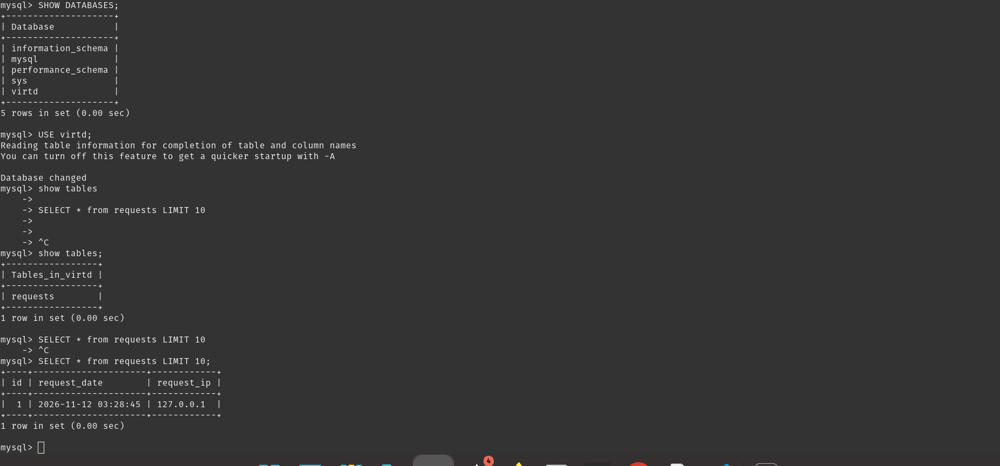
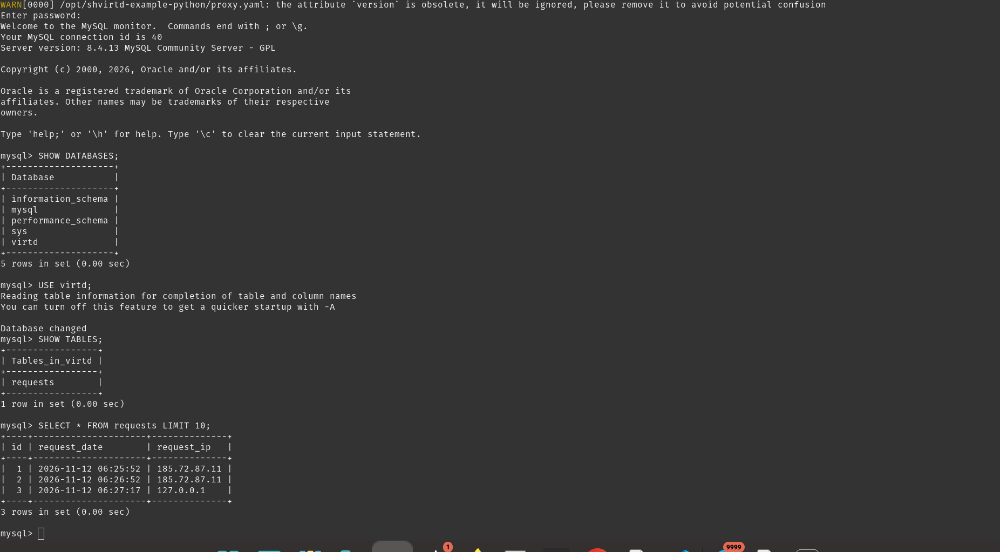
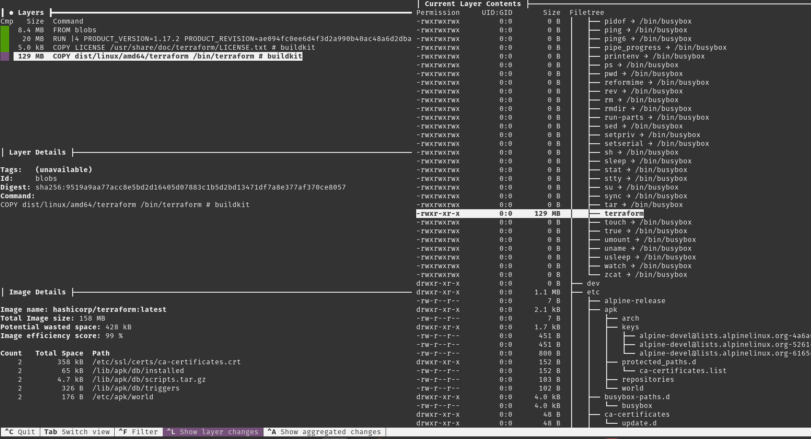
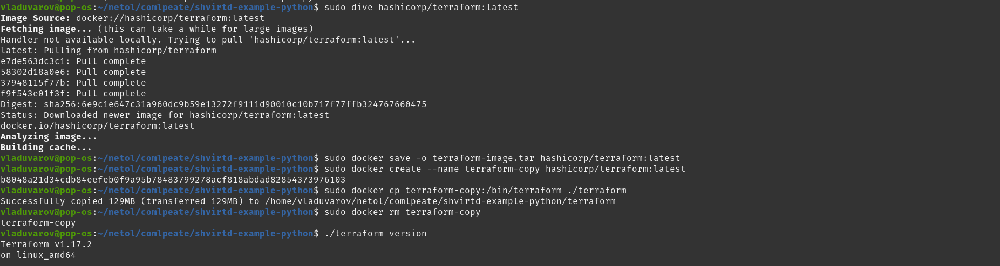

# Домашнее задание к занятию 05-virt-04 «Практическое применение Docker»

## Задача 1. Сборка образа Python-приложения

На основе проекта `shvirtd-example-python` создан [Dockerfile.python](./shvirtd-example-python/Dockerfile.python) с multistage-сборкой. На первом этапе устанавливаются зависимости, на втором собирается образ приложения на основе `python:3.12-slim`. Используется команда `COPY . .`, приложение запускается через Uvicorn на порту 5000.

Создан файл [.dockerignore](./shvirtd-example-python/.dockerignore), исключающий из контекста сборки служебные файлы Git, виртуальные окружения, кеш Python и `.env`.

## Задача 3. Docker Compose и MySQL

В [compose.yaml](./shvirtd-example-python/compose.yaml) подключен файл `proxy.yaml` с помощью директивы `include`. Описаны сервисы `web` и `db`, настроена сеть `backend` с адресами `172.20.0.5` и `172.20.0.10`. Сервис приложения собирается из `Dockerfile.python`, параметры подключения к MySQL задаются через `.env`.

После обращения к приложению в базе данных `virtd` создана таблица `requests`. Выполнены запросы для проверки базы, таблицы и сохраненных данных.

## Задача 4. Запуск проекта на виртуальной машине

Подготовлен [deploy.sh](./shvirtd-example-python/deploy.sh), который клонирует fork проекта в `/opt/shvirtd-example-python` и запускает его командой `docker compose up -d --build`.

На виртуальной машине выполнены запросы к базе данных `virtd`. В таблице `requests` отображаются сохраненные время запроса и IP-адрес.

## Задача 6. Извлечение Terraform из Docker-образа

Образ `hashicorp/terraform:latest` сохранен в файл `terraform-image.tar`. С помощью `dive` найден бинарный файл `/bin/terraform`, скопирован из контейнера и проверен. Версия бинарного файла — `Terraform v1.17.2` (`linux_amd64`).

